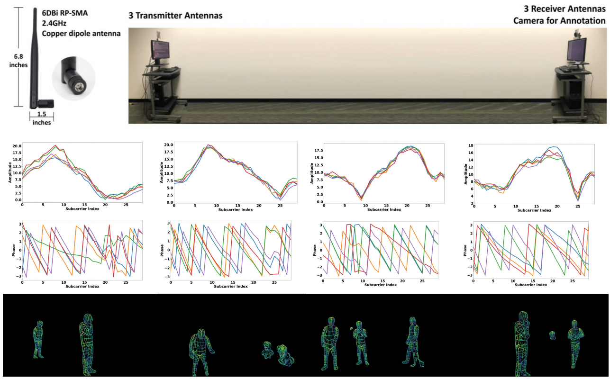

# Seefy

Sense movement in your home using only hardware you already own: your WiFi router, your phone and your laptop.

You teach it by walking the space once with your phone: the camera maps the rooms and tracks where you are, while the laptop listens to the WiFi traffic already in the air and records how each signal changes as your body moves through each spot. Afterwards, it reads WiFi alone, with no camera, and shows movement in the space. How much detail you get depends on what your hardware reports, from "someone is moving" up to "which room, and roughly where." The app tells you what to expect from yours.

Everything runs as one web app on your local network. There's no cloud and nothing to install on the phone.

**Status:** early build. See [docs/PLAN.md](docs/PLAN.md) for the full design and phases, and [docs/FIDELITY.md](docs/FIDELITY.md) for the settings that affect accuracy.

## Run it

```sh
uv sync                                  # host dependencies (Python 3.12)
cd web && npm install && npm run build   # web app
cd .. && ./seefy                        # prints the URL and a QR code
```

Open the URL on your phone (same WiFi). The first time, accept the certificate warning, or open the `http://…:8080` helper page to install the local certificate.

## Layout

| Path | What |
|---|---|
| `server/seefy/` | Host service (Python): HTTPS, WebSocket hub, clock sync, tag map, lens calibration, session recorder, signal capture |
| `web/` | Browser app (TypeScript + Vite): Live, Learn and Sensors screens |
| `docs/` | Plan and fidelity notes |

## Background

This started as an attempt to reproduce [*DensePose From WiFi*](https://arxiv.org/abs/2301.00250) (Geng, Huang, De la Torre, 2022). That paper maps WiFi signal measurements to dense human pose using a camera-supervised network. That work needed specialised WiFi cards. Seefy keeps the camera-as-teacher idea but aims at the stock hardware in any home. The repo began as Paul Wilson's experiments toward that paper (July 2023); they remain in the git history.


